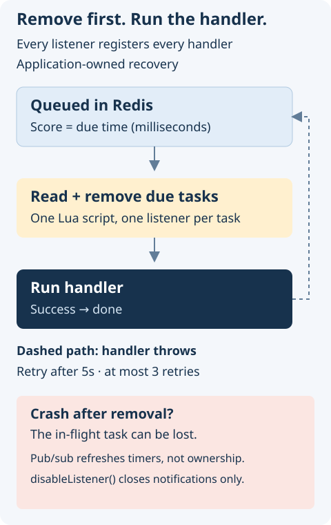

## Overview

`@antelopejs/interface-redis-scheduler` stores tasks in a Redis sorted set, with each due timestamp as the score. A local timer checks for due tasks, and Redis pub/sub tells listeners when the schedule changes. A handler that throws is retried. The scheduler does not give exactly-once delivery.

The scheduler code runs in your own module. It reaches Redis through `GetClient()` from `@antelopejs/interface-redis`, so the project must load a module that implements that interface, such as `@antelopejs/redis`. Where Redis keeps its data, and whether queued entries survive a Redis restart, depends on that module's connection settings and the Redis server's persistence configuration.

A listener takes due tasks with one Lua script that reads and removes them in a single step. Several listeners can share one queue, and each due entry goes to one of them. The entry leaves Redis before its handler runs, so a process failure after the removal and before the handler completes loses the task. Make handlers idempotent, because a retry runs the handler again after a failure that may already have had effects.

A listener that takes an entry whose handler name it has not registered removes the entry and does not run it, retry it, or log it. Register every handler in every process that calls `enableListener()`.

## Schedule a task safely

A task runs as expected when these four conditions hold:

1. Every process that adds, removes, or runs tasks of a type registers that type with [`setHandler`](#sethandler).
2. Each listener starts with [`enableListener`](#enablelistener) after its handlers are registered.
3. The application saves the serialized payload, then calls [`addTask`](#addtask) with a due time in milliseconds.
4. [`removeTask`](#removetask) receives that saved payload. A payload rebuilt with a new timestamp does not match.

{width="480"}

The scheduler fits work whose loss or repetition your application can tolerate or reconcile. It has no exactly-once execution, no durable record of which process runs a task, and no API that stops or drains processing. Read [retry logic](#retry-logic), [shutdown limits](#disablelistener), and [known limitations](#known-limitations) before you depend on it.

## Getting started

Install the package in your module:

```bash
npm install @antelopejs/interface-redis-scheduler
```

> **Note:** `@antelopejs/interface-redis` is a peer dependency. Install it too, and load a module that implements it, such as `@antelopejs/redis`, so the scheduler can connect to Redis.

## Try one scheduled task

This example runs in an initialized application against a disposable Redis database with no other scheduler listener. It logs a reminder after about one minute. It does not send an email or charge a payment.

```typescript
import {
  setHandler,
  enableListener,
  addTask,
} from "@antelopejs/interface-redis-scheduler";

setHandler("docs-reminder", (taskInfo) => {
  console.log("Reminder:", taskInfo);
});

await enableListener();
const taskInfo = JSON.stringify({
  jobId: "demo-001",
  message: "Review your draft",
});
await addTask("docs-reminder", Date.now() + 60_000, taskInfo);
```

The process must stay alive for the reminder to appear. The due time is a Unix timestamp in milliseconds, not a delay. Save `taskInfo` if you may later remove the queued entry, and note that [removal does not guarantee cancellation](#removetask). The API cannot fully stop the timers, so end this disposable process when you are done.

## Core concepts

The scheduler has three parts:

- **Handlers** process tasks of one type. Register them with `setHandler()` before you schedule tasks of that type.
- **Tasks** are entries in a Redis sorted set, scored by their due time. When a task is due, a listener calls the matching handler.
- **Listeners** watch the sorted set and run tasks when they fall due. Start one with `enableListener()`.

## `setHandler`

`setHandler` registers the handler for one task type. The name identifies the type, and the callback receives the task data as a string. The registration is local to the process and makes no Redis call. `sendEmail` below stands for a function in your application. It is not a scheduler export.

```typescript
import { setHandler } from "@antelopejs/interface-redis-scheduler";

declare function sendEmail(message: {
  to: string;
  subject: string;
  body: string;
}): Promise<void>;

setHandler("send-email", async (taskInfo) => {
  const emailData = JSON.parse(taskInfo);
  await sendEmail({
    to: emailData.recipient,
    subject: emailData.subject,
    body: emailData.body,
  });
});
```

A handler name must not contain the `:` character, because the scheduler uses it as a delimiter. Otherwise `setHandler` throws an `Error` with the message ``SchedulerUtil handler name may not contain `:` ``.

### Parameters

| Parameter     | Type                                          | Description                         |
| ------------- | --------------------------------------------- | ----------------------------------- |
| `handlerName` | `string`                                      | Unique identifier for the task type |
| `handler`     | `(taskInfo: string) => void \| Promise<void>` | Function that processes the task    |

## `enableListener`

`enableListener` starts task processing in this process. It opens a dedicated Redis subscriber connection, which receives the update messages that `addTask` publishes. It then arms a timer for the next due task, or runs the tasks that are already due.

```typescript
import { enableListener } from "@antelopejs/interface-redis-scheduler";

async function startApp() {
  // Register all handlers first.
  // ...

  await enableListener();
  console.log("Scheduler is active");
}
```

> **Important:** Register all task handlers before you call `enableListener()`. The listener starts processing due tasks right away.

## `disableListener`

`disableListener()` returns `Promise<void>` and only calls `quit()` on the notification subscriber. Call it only after `enableListener()` has completed. Before that, the subscriber does not exist and the call rejects.

> **Warning:** It does not clear the pending timer, cancel running handlers, or wait for tasks to complete. A timer that is already armed can still run tasks and arm another timer through `updateTimer()`. Do not use this function as a pause, a drain, or a guarantee that no more tasks run. The public API has no operation that stops the timer.

```typescript
import { disableListener } from "@antelopejs/interface-redis-scheduler";

async function stopApp() {
  await disableListener();
  console.log("Notification subscriber closed; task processing may continue");
}
```

## `addTask`

`addTask` schedules a task for a given time. It adds the task to the Redis sorted set with the due time as its score, then publishes an update message so listeners refresh their timers. While this process runs a batch of tasks, `addTask` does not publish. That process picks up the new task when its batch ends.

```typescript
import { addTask } from "@antelopejs/interface-redis-scheduler";

async function scheduleReminder(recipient: string) {
  // Due in 3 days.
  const dueTime = Date.now() + 3 * 24 * 60 * 60 * 1000;

  const taskInfo = JSON.stringify({
    recipient,
    subject: "Review your draft",
    body: "Your draft is waiting for review.",
    createdAt: new Date().toISOString(),
  });

  await addTask("send-email", dueTime, taskInfo);
  return taskInfo; // Persist this exact string for removal.
}
```

`addTask` rejects with `Unknown SchedulerUtil handler: <name>` when this process has not registered the handler name.

The pair of `handlerName` and `taskInfo` identifies the queued entry. Adding the same pair again changes its due time and does not create a second task. To keep two otherwise identical jobs apart, put a stable job ID in the payload.

### Parameters

| Parameter     | Type     | Description                                               |
| ------------- | -------- | --------------------------------------------------------- |
| `handlerName` | `string` | The registered handler name that processes this task      |
| `dueTime`     | `number` | Unix timestamp in milliseconds when the task is due       |
| `taskInfo`    | `string` | Data passed to the handler, usually a JSON-encoded string |

## `removeTask`

`removeTask` removes the original queued entry if it is still present. Pass the saved `taskInfo` string that `scheduleReminder` returned. Do not rebuild the JSON.

```typescript
import { removeTask } from "@antelopejs/interface-redis-scheduler";

async function removeQueuedReminder(savedTaskInfo: string) {
  await removeTask("send-email", savedTaskInfo);
}
```

`removeTask` rejects with `Unknown SchedulerUtil handler: <name>` when this process has not registered the handler name.

> **Warning:** The `taskInfo` must match the original string exactly. If the serialized JSON differs in key order or whitespace, nothing is removed and no error is raised.

Removal targets the original queued entry only. It does not stop a running handler, and it does not remove a retry stored with a `RETRY-` prefix. If a cancellation must survive races and retries, make the handler check cancellation state that your application owns before it applies effects.

### Parameters

| Parameter     | Type     | Description                                          |
| ------------- | -------- | ---------------------------------------------------- |
| `handlerName` | `string` | The handler name associated with the task            |
| `taskInfo`    | `string` | The exact task info string used when adding the task |

## Retry logic

The scheduler retries failed tasks with no extra code. When a handler throws or its promise rejects, the scheduler logs the error with `Logging.Error` and queues the task again with a retry counter.

- **Maximum retries.** 3 retries after the first attempt, so 4 attempts in total.
- **Retry delay.** Each retry is due 5 seconds after the attempt that failed.
- **Exhaustion.** After the third retry fails, the scheduler logs the error and discards the task.
- **Failed retry write.** When Redis rejects the write that queues a retry, the scheduler logs that error, the task gets no retry, and the batch goes on with its next task.

```typescript
import { setHandler } from "@antelopejs/interface-redis-scheduler";

declare function refreshSummary(data: unknown): Promise<void>;

// If this handler throws, the scheduler retries up to 3 times.
setHandler("refresh-summary", async (taskInfo) => {
  const data = JSON.parse(taskInfo);
  await refreshSummary(data);
  // On failure: retry after 5s, then 5s, then 5s, then discard.
});
```

`refreshSummary` is an application function that recomputes a replaceable summary. Choose work that is safe to retry and idempotent, because a retry does not prove that the failed attempt had no effect. Do not use this pattern as a durable payment-processing queue.

## Redis storage

The scheduler uses one Redis sorted set with the key `SchedulerUtil.Tasks`. Each entry has the form `handlerName:taskInfo`, and its score is the due timestamp in milliseconds.

A retried task has the form `RETRY-{count}:handlerName:taskInfo`, where `{count}` is the number of the retry, from 1 to 3.

The scheduler also uses a Redis pub/sub channel named `SchedulerUtil`. `addTask` publishes the message `update` on it, and each listener that receives it refreshes its timer. The messages do not assign tasks to a listener. The Lua script that takes due tasks does that.

## `updateTimer`

`updateTimer` reads the first queued task. If that task is already due, `updateTimer` runs the due tasks. Otherwise it arms a timer for the task's due time, capped at 24 hours. The timer does not keep the process alive on its own. A process with nothing else pending exits, and the task stays queued in Redis for the next listener. A listener calls `updateTimer` when it starts, when it receives an update message, and after each batch of tasks. While this process runs a batch, `updateTimer` returns without doing anything. You do not need to call it in normal usage.

```typescript
import { updateTimer } from "@antelopejs/interface-redis-scheduler";

// Force a timer refresh (advanced usage).
await updateTimer();
```

## `runTasks`

`runTasks` takes every task that is due and runs it. It removes the due tasks from Redis in one step, then calls their handlers one after another, earliest due time first. A task whose handler is not registered in this process is dropped. The retry logic applies to each handler that fails. When the batch ends, `runTasks` calls `updateTimer`. When the batch rejects, for example because Redis fails while it takes due tasks, `runTasks` releases its lock and rejects without arming a timer, so the due tasks run on the next update message or the next `updateTimer` call. The timer calls `runTasks` when it fires, so you do not need to call it in normal usage.

```typescript
import { runTasks } from "@antelopejs/interface-redis-scheduler";

// Run the due tasks now (advanced usage).
await runTasks();
```

## Complete example

This sketch registers handlers, starts the listener, schedules tasks, and closes the subscriber. `sendEmail`, `deleteSession`, and `refreshSummary` in these examples stand for application functions you supply. They are not scheduler exports. The example needs a configured Redis implementation and does not start a service from this page.

```typescript
import {
  setHandler,
  enableListener,
  disableListener,
  addTask,
  removeTask,
} from "@antelopejs/interface-redis-scheduler";

declare function sendEmail(
  to: string,
  subject: string,
  body: string,
): Promise<void>;
declare function deleteSession(sessionId: string): Promise<void>;

// 1. Register task handlers.
setHandler("send-email", async (taskInfo) => {
  const data = JSON.parse(taskInfo);
  await sendEmail(data.to, data.subject, data.body);
});

setHandler("cleanup-session", async (taskInfo) => {
  const { sessionId } = JSON.parse(taskInfo);
  await deleteSession(sessionId);
});

// 2. Start the listener.
async function start() {
  await enableListener();
}

// 3. Schedule tasks from your application logic.
async function onUserSignup(userId: string, email: string) {
  // Send a welcome email in 1 hour.
  const dueTime = Date.now() + 60 * 60 * 1000;
  await addTask(
    "send-email",
    dueTime,
    JSON.stringify({
      to: email,
      subject: "Welcome!",
      body: "Thanks for signing up.",
    }),
  );
}

async function onUserLogout(sessionId: string) {
  // Clean up session data in 24 hours.
  const dueTime = Date.now() + 24 * 60 * 60 * 1000;
  await addTask("cleanup-session", dueTime, JSON.stringify({ sessionId }));
}

// 4. Close notifications on shutdown. Pending timers and handlers may continue.
async function shutdown() {
  await disableListener();
}
```

## Known limitations

These behaviours are tracked as open issues:

- Two batches can run at the same time on one listener, so two handlers of one process can overlap ([#39](https://github.com/AntelopeJS/interface-redis-scheduler/issues/39)).
- When `removeTask` deletes the first queued task while `updateTimer` reads it, no timer is armed, and the remaining tasks wait for the next update message ([#38](https://github.com/AntelopeJS/interface-redis-scheduler/issues/38)).
