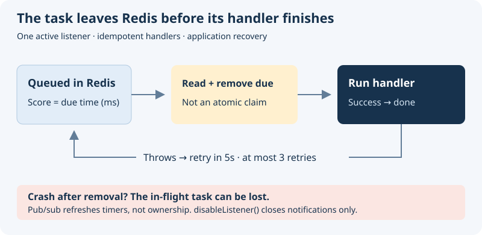

# Interface Redis Scheduler Documentation

## Overview

Interface Redis Scheduler stores tasks in a Redis sorted set with their due timestamps as scores. A local timer checks for due tasks, and Redis pub/sub notifies listeners when the schedule changes. Handlers that throw are retried, but the current implementation does not provide exactly-once delivery or an atomic claim across listeners.

Use one active listener for a queue and make handlers idempotent. Concurrent listeners can read the same due tasks before either removes them, and a process failure after removal but before handler completion can lose a task. Redis persistence protects queued entries only according to the server's persistence configuration.

## Schedule a task safely

1. Register the task type with [`setHandler`](#sethandler), including in processes that enqueue or remove tasks.
2. Start one active [`enableListener`](#enablelistener) for the queue after registering its handlers.
3. Save the serialized payload, then call [`addTask`](#addtask) with a due time in milliseconds.
4. Use that exact payload for [`removeTask`](#removetask); do not recreate timestamps when canceling.

{width="480"}

**Decide before adopting:** this scheduler fits work whose loss or repetition your application can tolerate or reconcile. It does not promise exactly-once execution, durable in-flight ownership, or a full shutdown/drain API. Review [retry logic](#retry-logic) and [shutdown limits](#disablelistener) before production use.

## Getting Started

Install the package in your project:

```bash
npm install @antelopejs/interface-redis-scheduler
```

> **Note:** This package depends on `@antelopejs/interface-redis`. You must have it installed and configured for the scheduler to connect to Redis.

## Try one scheduled task

Run this from an initialized application against a disposable Redis database,
with no other scheduler listener. It logs a reminder after about one minute;
it does not send an email or charge a payment.

```typescript
import {
  setHandler,
  enableListener,
  addTask,
} from "@antelopejs/interface-redis-scheduler";

setHandler("docs-reminder", (taskInfo) => {
  console.log("Reminder:", taskInfo);
});

await enableListener();
const taskInfo = JSON.stringify({
  jobId: "demo-001",
  message: "Review your draft",
});
await addTask("docs-reminder", Date.now() + 60_000, taskInfo);
```

Keep the process alive to observe the reminder. The due time is a Unix timestamp
in milliseconds, not a delay. Save `taskInfo` if you may later remove the queued
entry; [removal is not a cancellation guarantee](#removetask). The public API does
not fully stop timers, so end this disposable process when finished.

## Core Concepts

The scheduler operates around three main ideas:

- **Handlers** process tasks of a specific type. Register them with `setHandler()` before scheduling any tasks.
- **Tasks** are stored in a Redis sorted set with their due time as the score. When a task is due, the scheduler calls the matching handler.
- **Listener** monitors the sorted set and executes tasks when they become due. Enable it with `enableListener()`.

## `setHandler`

The `setHandler` function registers a handler for a specific task type. Each handler has a unique name and a callback function that receives the task data as a string. The `sendEmail` function below belongs to your application; it is not a scheduler export.

```typescript
import { setHandler } from "@antelopejs/interface-redis-scheduler";

setHandler("send-email", async (taskInfo) => {
  const emailData = JSON.parse(taskInfo);
  await sendEmail({
    to: emailData.recipient,
    subject: emailData.subject,
    body: emailData.body,
  });
});
```

Handler names must not contain the `:` character, as the scheduler uses it internally as a delimiter.

### Parameters

| Parameter     | Type                                          | Description                         |
| ------------- | --------------------------------------------- | ----------------------------------- |
| `handlerName` | `string`                                      | Unique identifier for the task type |
| `handler`     | `(taskInfo: string) => void \| Promise<void>` | Function that processes the task    |

## `enableListener`

The `enableListener` function starts the task execution loop. It creates a dedicated Redis subscriber connection to receive real-time notifications when new tasks are added, and sets up a timer to check for due tasks.

```typescript
import { enableListener } from "@antelopejs/interface-redis-scheduler";

async function startApp() {
  // Register all handlers first
  // ...

  // Then start the listener
  await enableListener();
  console.log("Scheduler is active");
}
```

> **Important:** Register all task handlers before calling `enableListener()`. The listener begins processing tasks immediately.

## `disableListener`

`disableListener()` returns `Promise<void>` and only calls `quit()` on the notification subscriber. Call it only after `enableListener()` has completed successfully.

> **Warning:** It does not clear the pending timer, cancel running handlers, or wait for task completion. An already scheduled timer can still execute tasks and schedule another timer through `updateTimer()`. Do not use this function as a pause, a drain, or a guarantee that no more tasks run. The current public API has no complete timer shutdown operation.

```typescript
import { disableListener } from "@antelopejs/interface-redis-scheduler";

async function stopApp() {
  await disableListener();
  console.log("Notification subscriber closed; task processing may continue");
}
```

## `addTask`

The `addTask` function schedules a task for execution at a specific time. The task is stored in a Redis sorted set with the due time as its score.

```typescript
import { addTask } from "@antelopejs/interface-redis-scheduler";

async function scheduleReminder(recipient: string) {
  // Schedule for 3 days from now
  const dueTime = Date.now() + 3 * 24 * 60 * 60 * 1000;

  const taskInfo = JSON.stringify({
    recipient,
    subject: "Review your draft",
    body: "Your draft is waiting for review.",
    createdAt: new Date().toISOString(),
  });

  await addTask("send-email", dueTime, taskInfo);
  return taskInfo; // Persist this exact string for removal.
}
```

The function throws an error if the specified handler name has not been registered.

The pair `handlerName` + `taskInfo` identifies the queued member. Adding the same pair again changes its due time rather than creating another independent task. Include a stable job ID in the payload when two otherwise identical jobs must remain distinct.

### Parameters

| Parameter     | Type     | Description                                                  |
| ------------- | -------- | ------------------------------------------------------------ |
| `handlerName` | `string` | The registered handler name that processes this task         |
| `dueTime`     | `number` | Unix timestamp in milliseconds when the task should execute  |
| `taskInfo`    | `string` | Data passed to the handler (typically a JSON-encoded string) |

## `removeTask`

The `removeTask` function removes the original queued entry, if it is still present. Pass the saved `taskInfo` string returned by `scheduleReminder`, rather than reconstructing the JSON.

```typescript
import { removeTask } from "@antelopejs/interface-redis-scheduler";

async function removeQueuedReminder(savedTaskInfo: string) {
  await removeTask("send-email", savedTaskInfo);
}
```

The function throws an error if the specified handler name has not been registered.

> **Warning:** The `taskInfo` must be an exact string match of the original task. If the serialized JSON differs in key order or whitespace, the removal fails silently.

Removal targets the original queued member only. It does not stop a running handler or remove a retry stored with a `RETRY-` prefix. If cancellation must survive races and retries, make the handler check application-owned cancellation state before applying effects.

### Parameters

| Parameter     | Type     | Description                                          |
| ------------- | -------- | ---------------------------------------------------- |
| `handlerName` | `string` | The handler name associated with the task            |
| `taskInfo`    | `string` | The exact task info string used when adding the task |

## Retry Logic

The scheduler automatically retries failed tasks. When a handler throws an error, the scheduler reschedules the task with a retry counter.

- **Maximum retries:** 3 retries after the initial attempt (4 attempts total)
- **Retry delay:** 5 seconds between each attempt
- **Behavior on exhaustion:** After 3 failed retries, the task is discarded; failures are reported through `Logging.Error`

No additional code is required to enable retries. The mechanism is built into the task execution loop.

```typescript
import { setHandler } from "@antelopejs/interface-redis-scheduler";

// If this handler throws, the scheduler retries up to 3 times
setHandler("refresh-summary", async (taskInfo) => {
  const data = JSON.parse(taskInfo);
  await refreshSummary(data);
  // On failure: retry after 5s, then 5s, then 5s, then discard
});
```

`refreshSummary` is an application function that recomputes a replaceable summary.
Choose retryable, idempotent work; a retry is not proof that the previous attempt
had no effect. Do not use this sketch as a durable payment-processing queue.

## Redis Storage

The scheduler uses a single Redis sorted set with the key `SchedulerUtil.Tasks`. Each member in the sorted set follows the format `handlerName:taskInfo`, and its score is the due timestamp in milliseconds.

For retried tasks, the format becomes `RETRY-{count}:handlerName:taskInfo`, where `{count}` tracks the number of retry attempts.

The scheduler also uses a Redis pub/sub channel named `SchedulerUtil` to notify listener instances when new tasks are added. These notifications refresh timers; they do not lock or atomically claim tasks across processes.

## `updateTimer`

The `updateTimer` function refreshes the internal timer that tracks the next due task. The scheduler calls this function automatically when tasks are added or completed. You do not need to call it in normal usage.

```typescript
import { updateTimer } from "@antelopejs/interface-redis-scheduler";

// Force a timer refresh (advanced usage)
await updateTimer();
```

## `runTasks`

The `runTasks` function executes all tasks that are currently due. The scheduler calls this function automatically when the timer fires. It includes the retry logic for failed tasks. You do not need to call it in normal usage.

```typescript
import { runTasks } from "@antelopejs/interface-redis-scheduler";

// Manually trigger task execution (advanced usage)
await runTasks();
```

## Complete Example

This integration sketch shows handler registration, listener startup, scheduling, and subscriber cleanup. `sendEmail`, `deleteSession`, and `refreshSummary` in these examples stand for application functions you supply; they are not scheduler exports. The examples require a configured Redis implementation and do not run a service from this page.

```typescript
import {
  setHandler,
  enableListener,
  disableListener,
  addTask,
  removeTask,
} from "@antelopejs/interface-redis-scheduler";

// 1. Register task handlers
setHandler("send-email", async (taskInfo) => {
  const data = JSON.parse(taskInfo);
  await sendEmail(data.to, data.subject, data.body);
});

setHandler("cleanup-session", async (taskInfo) => {
  const { sessionId } = JSON.parse(taskInfo);
  await deleteSession(sessionId);
});

// 2. Start the listener
async function start() {
  await enableListener();
}

// 3. Schedule tasks from your application logic
async function onUserSignup(userId: string, email: string) {
  // Send a welcome email in 1 hour
  const dueTime = Date.now() + 60 * 60 * 1000;
  await addTask(
    "send-email",
    dueTime,
    JSON.stringify({
      to: email,
      subject: "Welcome!",
      body: "Thanks for signing up.",
    }),
  );
}

async function onUserLogout(sessionId: string) {
  // Clean up session data in 24 hours
  const dueTime = Date.now() + 24 * 60 * 60 * 1000;
  await addTask("cleanup-session", dueTime, JSON.stringify({ sessionId }));
}

// 4. Close notifications on shutdown (pending timers and handlers may continue)
async function shutdown() {
  await disableListener();
}
```
